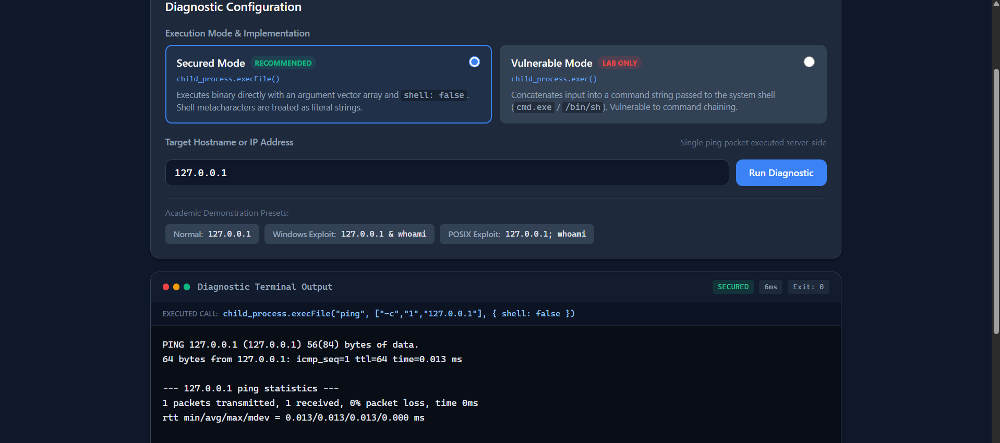
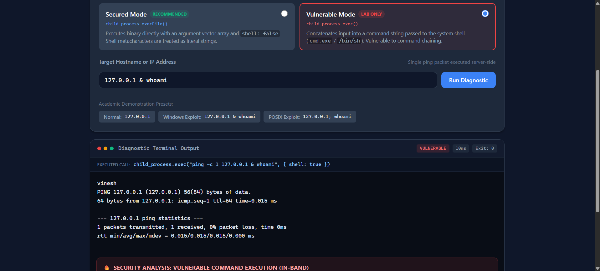
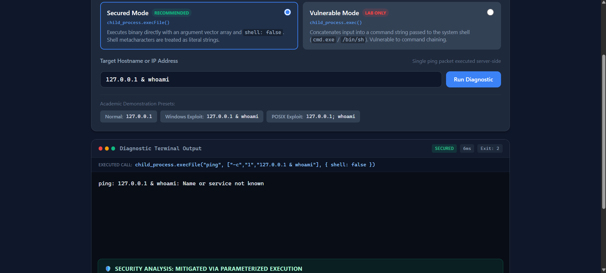

# In-band OS Command Injection & Parameterized Execution Lab

Vinesh Suravarapu
IIT2024138

[](https://nodejs.org/)
[](https://opensource.org/licenses/ISC)
[]()
[-critical.svg)](https://cwe.mitre.org/data/definitions/78.html)

A complete college Cyber Security assignment on **Web Server Security**, demonstrating **In-band OS Command Injection (CWE-78)** and its definitive mitigation using **Parameterized Command Execution** (`child_process.execFile` with argument vectors and shell invocation disabled).

The application implements a realistic **Network Diagnostic Tool** providing side-by-side implementations:
1. **Deliberately Vulnerable Implementation**: Uses `child_process.exec()` with untrusted string concatenation executed through the operating system shell (`cmd.exe` on Windows or `/bin/sh` on POSIX).
2. **Secured Implementation**: Uses `child_process.execFile()` with an explicit argument vector (`argv` array) and shell interpretation disabled (`shell: false`).

---

## Table of Contents

- [1. Project Architecture & File Structure](#1-project-architecture--file-structure)
- [2. Vulnerability Variant: In-band OS Command Injection](#2-vulnerability-variant-in-band-os-command-injection)
- [3. Technology Stack](#3-technology-stack)
- [4. Installation & Quick Start](#4-installation--quick-start)
- [5. Manual Testing & Visual Demonstration](#5-manual-testing--visual-demonstration)
  - [TEST 1: Normal Diagnostic Operation (`1.png`)](#test-1-normal-diagnostic-operation-1png)
  - [TEST 2: In-band Command Injection Exploitation (`2.png`)](#test-2-in-band-command-injection-exploitation-2png)
  - [TEST 3: Parameterized Mitigation Verification (`3.png`)](#test-3-parameterized-mitigation-verification-3png)
  - [Comparative Summary Table](#comparative-summary-table)
- [6. Vulnerability Root Cause Analysis](#6-vulnerability-root-cause-analysis)
- [7. Implemented Mitigation: Parameterized Execution](#7-implemented-mitigation-parameterized-execution)
- [8. Additional Defense-in-Depth Mitigations](#8-additional-defense-in-depth-mitigations)
- [9. Strict Local-Lab Safety Controls](#9-strict-local-lab-safety-controls)
- [10. Automated Safety Verification Suite](#10-automated-safety-verification-suite)


---

## 1. Project Architecture & File Structure

The project has been organized into a clean, minimal, production-grade structure ready for submission:

```
OS-Command-Injection/
|
|-- 1.png                            # Visual Proof: Normal diagnostic ping execution (127.0.0.1)
|-- 2.png                            # Visual Proof: In-band command injection exploit (whoami -> vinesh)
|-- 3.png                            # Visual Proof: Parameterized mitigation blocking execution
|
|-- server.js                        # Express server, command execution logic, and localhost:3000 binding
|-- package.json                     # Project manifest, dependencies (express), and lifecycle scripts
|-- package-lock.json                # Deterministic dependency tree lockfile
|-- .gitignore                       # Clean repository rules (excludes node_modules, logs, env files)
|-- README.md                        # Complete master assignment documentation and viva guide
|
|-- public/                          # Frontend single-page application (vanilla HTML/CSS/JS)
|   |-- index.html                   # Diagnostic UI, mode toggle cards, and terminal viewport
|   |-- style.css                    # Professional dark-slate theme with accessible contrast
|   |-- script.js                    # Fetch client, safe textContent rendering, live analysis engine
|
|-- test/                            # Automated safety verification test suite
|   |-- app.test.js                  # 12 automated structural and safety unit/integration tests
```

---

## 2. Vulnerability Variant: In-band OS Command Injection

- **Common Weakness Enumeration**: [CWE-78: Improper Neutralization of Special Elements used in an OS Command ('OS Command Injection')](https://cwe.mitre.org/data/definitions/78.html)
- **Attack Variant**: **In-band (Direct / Output Returned)**
- **Definition**: An in-band command injection occurs when an application receives untrusted user input, incorporates it into an operating system shell command, executes the command, and **directly transmits the resulting `stdout` or `stderr` streams back within the HTTP response**.
- **Distinction from Blind Injection**:
  - *In-band*: The attacker immediately sees the command output (e.g. `whoami` returning username `vinesh`) in the HTTP response body and browser viewport.
  - *Blind*: The command output is discarded or suppressed by the server. The attacker must deduce execution through time delays (`ping -n 5 127.0.0.1` or `sleep 5`) or out-of-band network callbacks (DNS/HTTP callbacks).

---

## 3. Technology Stack

- **Runtime**: Node.js (v18.0.0 or higher; developed on Node v23)
- **Backend Framework**: Express.js (v4.21.2) &mdash; minimal, robust REST API server
- **Command Execution Engine**: Node.js native `child_process` module:
  - Vulnerable path: `child_process.exec()` (spawns shell interpreter)
  - Secured path: `child_process.execFile()` (direct binary invocation with argument array and `shell: false`)
- **Frontend**: Plain HTML5, Modern CSS3, and Vanilla JavaScript (zero external frontend frameworks)
- **Safe Output Rendering**: DOM `textContent` exclusively (strictly avoids `innerHTML` to eliminate Cross-Site Scripting)
- **Automated Test Runner**: Node.js built-in `node:test` and `node:assert/strict`

---

## 4. Installation & Quick Start

### Prerequisites
- Node.js (>= 18.0.0)
- npm (Node Package Manager)

### Step 1: Install Dependencies
```bash
npm install
```

### Step 2: Run the Application

#### Option A: Normal Secured Mode (Default)
Starts the server with only the secured implementation active. The vulnerable endpoint is disabled and returns `403 Forbidden`.
```bash
npm start
```

#### Option B: Local Vulnerable Lab Mode (For Exploitation Demonstration)
Enables both the vulnerable and secured implementations for controlled local academic testing.
```bash
npm run lab
```

### Step 3: Access the Interface
Open your browser and navigate to:
```
http://127.0.0.1:3000
```

### Step 4: Run the Automated Test Suite
Verify all 12 security constraints, binding boundaries, and argument-vector structures:
```bash
npm test
```

---

## 5. Manual Testing & Visual Demonstration

The following three manual tests demonstrate legitimate execution, successful in-band exploitation, and definitive mitigation. The screenshots captured directly from our running application illustrate each step:

---

### TEST 1: Normal Diagnostic Operation (`1.png`)

- **Objective**: Verify normal diagnostic ping functionality for authorized hostnames/IPs.
- **Active Mode**: Secured Mode (`child_process.execFile()`)
- **Target Input**: `127.0.0.1`
- **Executed Process Call**:
  ```javascript
  child_process.execFile("ping", ["-c", "1", "127.0.0.1"], { shell: false })
  ```



#### Observed Result:
- The server executes a single ping packet (`-c 1` on POSIX / `-n 1` on Windows) to loopback address `127.0.0.1`.
- The terminal panel captures and displays the legitimate ICMP echo replies:
  ```
  PING 127.0.0.1 (127.0.0.1) 56(84) bytes of data.
  64 bytes from 127.0.0.1: icmp_seq=1 ttl=64 time=0.013 ms

  --- 127.0.0.1 ping statistics ---
  1 packets transmitted, 1 received, 0% packet loss, time 0ms
  ```
- **Execution Metadata**: Status: `SECURED`, Duration: `6ms`, Exit Code: `0`.

---

### TEST 2: In-band Command Injection Exploitation (`2.png`)

- **Objective**: Demonstrate that unsanitized input concatenated into `child_process.exec()` allows an attacker to chain and execute arbitrary harmless commands.
- **Server Startup**: `npm run lab`
- **Active Mode**: Vulnerable Mode (`child_process.exec()`) &mdash; [LAB ONLY]
- **Target Input**:
  ```cmd
  127.0.0.1 & whoami
  ```
  *(On POSIX systems, `127.0.0.1; whoami` or `127.0.0.1 & whoami`)*
- **Executed Shell Command**:
  ```javascript
  child_process.exec("ping -c 1 127.0.0.1 & whoami", { shell: true })
  ```



#### Observed Result:
- The system shell (`cmd.exe` or `/bin/sh`) parses the `&` symbol as a command separator.
- It executes `ping -c 1 127.0.0.1`, followed immediately by the injected command: `whoami`.
- **In-band Evidence**: In the terminal panel, the output of `whoami` is returned directly above the ping statistics:
  ```
  vinesh
  PING 127.0.0.1 (127.0.0.1) 56(84) bytes of data.
  64 bytes from 127.0.0.1: icmp_seq=1 ttl=64 time=0.015 ms
  ```
- The username `vinesh` is returned in the HTTP response stream to the browser.
- **Security Analysis**: Confirms **In-band OS Command Injection (CWE-78)**. Arbitrary operating system commands execute under the privilege of the running Node.js process.

---

### TEST 3: Parameterized Mitigation Verification (`3.png`)

- **Objective**: Prove that parameterized execution via `child_process.execFile()` completely blocks command injection without relying on fragile string blocklists.
- **Active Mode**: Secured Mode (`child_process.execFile()`) &mdash; [RECOMMENDED]
- **Target Input**: Exact same payload as Test 2:
  ```cmd
  127.0.0.1 & whoami
  ```
- **Executed Process Call**:
  ```javascript
  child_process.execFile("ping", ["-c", "1", "127.0.0.1 & whoami"], { shell: false })
  ```



#### Observed Result:
- The injected command `whoami` **DOES NOT execute**. The username `vinesh` never appears.
- Because `shell: false` is enforced, no shell interpreter is launched to evaluate `&`.
- The entire string `"127.0.0.1 & whoami"` is passed as a single literal argument (`argv[2]`) to the `ping` executable.
- The `ping` binary attempts to look up `"127.0.0.1 & whoami"` as a single hostname, fails, and outputs its standard error:
  ```
  ping: 127.0.0.1 & whoami: Name or service not known
  ```
- **Execution Metadata**: Status: `SECURED`, Duration: `6ms`, Exit Code: `2` (non-zero due to invalid host).
- **Security Analysis**: Confirms **Parameterized Execution Mitigation**. The attack payload was isolated strictly to data and could not cross into code execution.

---

### Comparative Summary Table

| Evaluation Criterion | Vulnerable Mode (`2.png`) | Secured Mode (`3.png`) |
| :--- | :--- | :--- |
| **API Endpoint** | `POST /api/ping/vulnerable` | `POST /api/ping/secured` |
| **Node.js Function** | `child_process.exec()` | `child_process.execFile()` |
| **Shell Invoked?** | **YES** (`cmd.exe` or `/bin/sh`) | **NO** (`shell: false`) |
| **Metacharacter `&`** | Evaluated as command separator | Treated as literal string data |
| **`whoami` Executed?** | **YES** (Output: `vinesh`) | **NO** (Never spawned by OS) |
| **Returned Stream** | Injected output + ping output | Host resolution error only |
| **Security Status** | **CRITICAL VULNERABILITY (CWE-78)** | **IMMUNE TO COMMAND INJECTION** |

---

## 6. Vulnerability Root Cause Analysis

The root cause of OS Command Injection lies in the **confusion between code and data** when calling a command-line interpreter:

```
[Untrusted Input] ---> [String Concatenation] ---> [System Shell Parser] ---> [OS Kernel Execution]
```

1. **String Concatenation**: In `server.js`, the vulnerable implementation builds the command string using string interpolation:
   ```javascript
   // DELIBERATELY VULNERABLE CODE (server.js)
   const constructedCommand = isWindows
     ? `ping -n ${PING_PACKET_COUNT} ${target}`
     : `ping -c ${PING_PACKET_COUNT} ${target}`;
   ```
2. **Spawning the Shell**: `child_process.exec()` launches the operating system command processor (`cmd.exe` on Windows or `/bin/sh` on POSIX).
3. **Lexical Analysis & Metacharacters**: The shell parser evaluates control characters (`&`, `&&`, `;`, `|`, `||`) before running any program. When `target` is `127.0.0.1 & whoami`, the shell tokenizes the string into two independent commands:
   - Command 1: `ping -c 1 127.0.0.1`
   - Command 2: `whoami`
4. **In-band Stream Merging**: The shell pipes both `stdout` streams back to Node.js, which sends the output across the HTTP connection to the browser.

---

## 7. Implemented Mitigation: Parameterized Execution

The secured implementation completely eliminates command injection at the architectural level:

```javascript
// SECURED MITIGATION (server.js)
const executable = PING_BINARY; // 'ping'
const args = [PING_COUNT_FLAG, PING_PACKET_COUNT, target]; // ['-c', '1', '127.0.0.1 & whoami']

execFile(
  executable,
  args,
  {
    shell: false,                     // MANDATORY: No shell spawned
    timeout: COMMAND_TIMEOUT_MS,      // Process execution ceiling (5000ms)
    maxBuffer: MAX_BUFFER_BYTES,      // Memory buffer ceiling (64KB)
    windowsHide: true
  },
  (error, stdout, stderr) => { ... }
);
```

### Why Parameterized Execution Works
1. **Direct Kernel Process Invocation**: Instead of launching a shell, Node.js uses `CreateProcessW` (Windows) or `execve` (POSIX).
2. **Argument Vector (`argv`) Isolation**: The binary name and its parameters are stored in discrete memory pointers.
3. **No Shell Tokenizer (`shell: false`)**: Because no shell is active, characters like `&`, `;`, `|`, and spaces have zero syntactic meaning. They are passed as literal text data to the `ping` utility.
4. **Academic Isolation Note**: We intentionally do not block `127.0.0.1 & whoami` with a regex allow-list before calling `execFile()`. This provides undeniable proof that argument-vector execution alone neutralizes the injection at the OS process boundary.

---

## 8. Additional Defense-in-Depth Mitigations

In production environments, security engineers implement defense-in-depth:

### 1. Avoid Spawning External Shells
Prefer native programming language APIs over command-line utilities. For example, use Node.js's built-in `dns.lookup()` instead of running CLI `nslookup`.

### 2. Strict Input Allow-list Validation
Validate all inputs against strict syntactic rules before passing them to any system API:
```javascript
// Example: Strict IPv4 and Hostname Allow-list Regex
const HOSTNAME_OR_IP_REGEX = /^(?:(?:25[0-5]|2[0-4]\d|[01]?\d\d?)\.){3}(?:25[0-5]|2[0-4]\d|[01]?\d\d?)$|^[a-zA-Z0-9](?:[a-zA-Z0-9-]{0,61}[a-zA-Z0-9])?(?:\.[a-zA-Z0-9](?:[a-zA-Z0-9-]{0,61}[a-zA-Z0-9])?)*$/;

if (!HOSTNAME_OR_IP_REGEX.test(target)) {
  return res.status(400).json({ error: 'Invalid hostname or IP address format.' });
}
```

### 3. Principle of Least Privilege
- Run web servers under dedicated, unprivileged service accounts (e.g. `www-data`), never as `root` or `Administrator`.
- Apply OS containerization (Docker with non-root user) and systemd security sandboxing (`ProtectSystem=strict`, `NoNewPrivileges=true`).

---

## 9. Strict Local-Lab Safety Controls

To adhere to academic safety and ethical guidelines:
1. **Localhost Binding Exclusively**: `server.js` binds strictly to `127.0.0.1`. Attempts to bind to `0.0.0.0` or external interfaces throw an immediate fatal error.
2. **Disabled-by-Default Vulnerable Mode**: `/api/ping/vulnerable` returns `403 Forbidden` unless the server is explicitly launched via `npm run lab` (`LAB_MODE=true`).
3. **Production Mode Guard**: If `NODE_ENV=production` is detected alongside `LAB_MODE=true`, the server halts immediately.
4. **Execution Ceilings**: All child processes enforce a 5-second timeout and a 64 KB memory buffer.
5. **Safe DOM Text Rendering**: The frontend uses `element.textContent` exclusively, eliminating Reflected Cross-Site Scripting (XSS).
6. **Harmless Demonstration Payload**: Testing is restricted exclusively to read-only `whoami` commands.

---

## 10. Automated Safety Verification Suite

The repository includes an automated test suite implemented using Node.js's native `node:test` runner.

### Running the Test Suite
```bash
npm test
```

### Verified Test Cases (12 Tests Passing)
1. **Host Binding**: Verifies default host is strictly `127.0.0.1`.
2. **Host Restriction**: Confirms `startServer` rejects non-localhost bindings (e.g. `0.0.0.0`).
3. **Security Headers**: Asserts presence of `nosniff`, `DENY`, and `Content-Security-Policy`.
4. **API Discovery**: Validates `GET /api/status` returns environment and platform configuration.
5. **Lab Mode Gate**: Confirms `/api/ping/vulnerable` returns `403 Forbidden` in default mode.
6. **Empty Input Validation**: Asserts `400 Bad Request` on missing or whitespace-only inputs.
7. **Length Validation**: Asserts `400 Bad Request` on oversized inputs (> 256 characters).
8. **Parameterized Structure**: Verifies secured endpoint uses `execFile` with argument vector array and `shell: false`.
9. **Static Assets**: Asserts that `index.html`, `style.css`, and `script.js` are served correctly.
10. **Legitimate Execution**: Verifies normal ping to `127.0.0.1` exits with code 0 and valid output.
11. **Production Guard**: Verifies server aborts if `NODE_ENV=production` and `LAB_MODE=true`.
12. **Lab Mode Lifecycle**: Asserts that `npm run lab` enables `/api/ping/vulnerable`.

---

